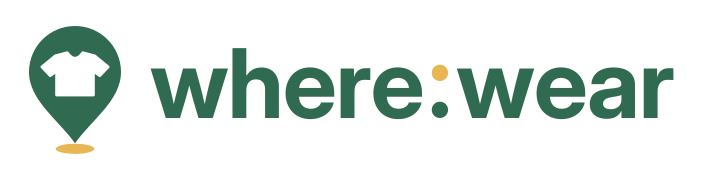
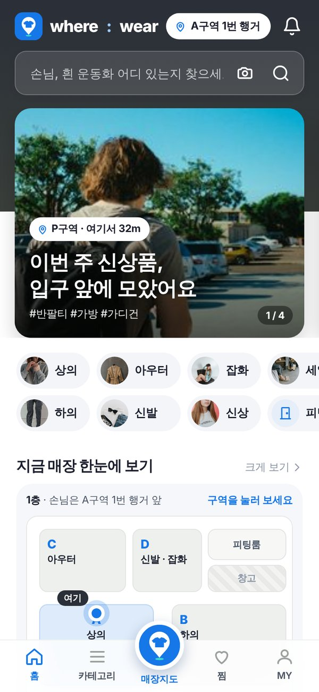
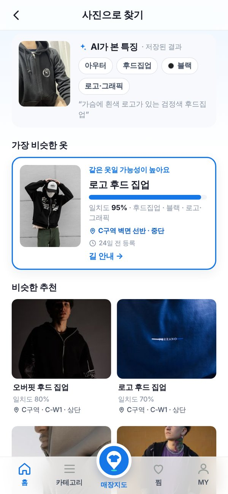
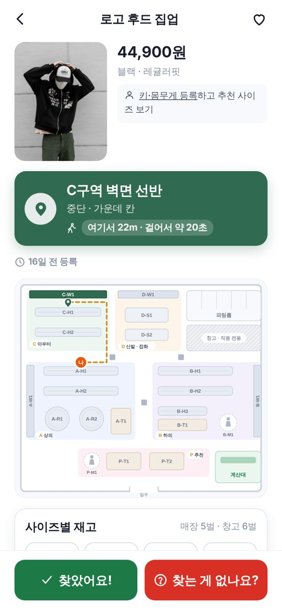
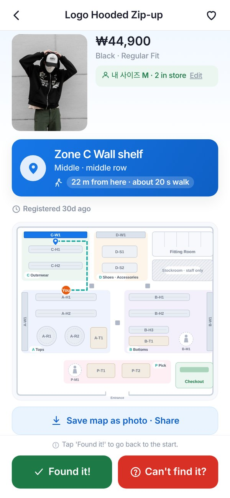
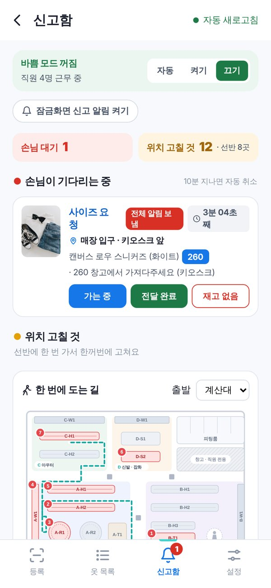
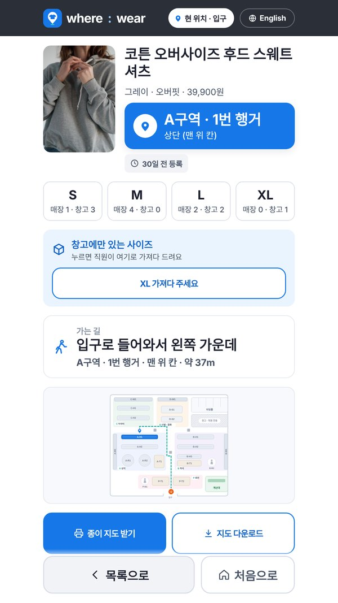
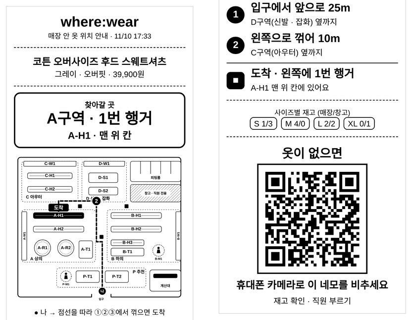

<p align="center"></p>

<h3 align="center">묻지 않아도 찾을 수 있는 매장</h3>
<p align="center">찾는 옷이 매장의 <b>어느 구역 · 어느 행거 · 어느 단</b>에 있는지 알려 주는 의류 매장 위치 안내 웹 서비스<br>(GPS · 비콘 · RFID 없이 Flask + SQLite)</p>

<p align="center">
광운대학교 정보융합학부 <b>뿌셔뿌셔조</b> (김준구 · 류한솔 · 이준혁)<br>
제2회 인공지능 활용 우수사례 공모전 제작부문 출품작
</p>

<p align="center">
<a href="https://youtu.be/30Rv38LvmzM"></a><br>
▶ <a href="https://youtu.be/30Rv38LvmzM"><b>시연 영상 보기 (1분)</b></a> — 글자 · 사진(AI) 검색, 키오스크 종이 지도, English, 직원 화면
</p>

---

## 실행 방법

```bash
pip install -r requirements.txt
python import_catalog.py      # catalog.csv → store.db (처음 한 번)
python app.py                 # http://localhost:5001/go?at=A-H1
```

- 사진으로 찾기(AI)를 쓰려면 [Google AI Studio](https://aistudio.google.com/apikey)에서 받은 Gemini 키를 `gemini_key.txt`에 넣으세요. 키는 `.gitignore`로 제외되어 저장소에 없습니다. 키가 없으면 사진의 대표 색으로 찾습니다.
- 발표용 예시 데이터: `/demo`
- macOS: `서버켜기.command` 더블클릭

---

## 한눈에 보기

| 손님 QR · 홈 | 사진으로 찾기 (AI) | 위치 + 2D 길 안내 | English | 직원 신고함 |
|:---:|:---:|:---:|:---:|:---:|
|  |  |  |  |  |
| 매장 QR을 찍으면<br>앱 없이 바로 열림 | Vision AI가 옷 특징을 뽑고<br>가장 비슷한 옷을 일치도와 함께 | "C구역 · 벽면 선반 · 중단"<br>+ 경로 · 사이즈별 재고 | 휴대폰 언어에 맞춰<br>영어 화면 | 손님 신고 · 호출 확인<br>+ 한 번에 도는 경로 |

| 키오스크 (40대 이상) | 종이 지도 (80mm 감열지) |
|:---:|:---:|
|  |  |
| 큰 글씨 · 글자 입력 없이 3번 터치 | 도면 + 꺾는 곳마다 번호 안내 (왼쪽 → 오른쪽 순서) |

> 화면은 모두 이 저장소의 코드를 실행해 캡처했습니다. 신고함 숫자는 시연 모드(`/demo`)의 예시 데이터입니다.

---

## Why?

| 근거 | 수치 |
|---|---|
| 매장에서 옷 찾기에 어려움을 겪음 (자체 설문 100명) | **87%** |
| 5분 이상 헤매거나 결국 포기 | **79%** |
| 못 찾으면 포기하거나 온라인으로 이탈 | **45%** |
| 위치 · 길 안내 기능이 필요하다 | **68%** |
| 못 찾아서 빈손으로 나간 비율 — 재고가 없어서 나간 비율(66.3%)보다 높음 (iVend Retail, 9개국 2,250명) | **67.3%** |

직원에게 물으면 되지만, 말 걸기 부담스러운 손님 · 키오스크가 어려운 어르신 · 한국어가 서툰 외국인에게는 그마저 쉽지 않습니다.
현장 직원 인터뷰에서도 "손님 절반이 위치를 묻는다"는 답을 들었습니다.

### 기존 사례와 다른 점

| | 고객용 | 직원용 |
|---|---|---|
| **마트** | 월마트 · 이마트 — 통로 번호 안내 (진열 고정 전제) | 재고관리 시스템 |
| **의류** | **where:wear** (자라 · 무신사는 '있다/없다'까지만) | Nedap RFID 위치 찾기 |

- **측위 장비 없음** — QR 하나하나에 자기 자리(`/go?at=A-H1`)가 담겨 있어, 찍는 순간 출발점이 정해집니다. GPS · 비콘 · RFID가 필요 없습니다.
- **좌표가 아니라 구역 · 집기 · 단으로 안내** — 옷이 근처로 옮겨져도 안내가 유효합니다.
- **매장을 바꾸지 않음** — 기존 매장에 QR 스티커와 태블릿만 더하면 됩니다. 결제 · 로그인 · 앱 설치도 없습니다.

---

## AI 활용

### 1. 서비스 안 — Google Gemini로 사진 속 옷 찾기 ([`vision.py`](vision.py))

```
사진 → 회전 보정 · 768px 축소 → Gemini (특징 추출만) → JSON → 코드가 매장 옷 206개와 점수 비교 → 1등 + 비슷한 추천
```

**프롬프트 (원문)**

```text
너는 의류 매장의 상품 분류 담당자다. 사진 속 가장 크게 보이는 옷 한 벌만 보고 특징을 고른다.
- 사람이 입고 있으면 사람은 무시하고 옷만 본다. 여러 벌이면 가장 크고 가운데 있는 것.
- color는 옷 몸판의 주된 색 하나. 조명 때문에 생긴 그림자·반사는 무시.
- 짙은 남색은 네이비, 밝은 하늘색은 스카이블루, 아이보리·크림은 화이트, 차콜은 그레이.
- 핏을 사진으로 판단하기 어려우면 알수없음.
- 옷이 아니면 is_clothing=false 로 하고 나머지는 가장 가까운 값을 아무거나 넣는다.
- desc는 한국어 20자 이내로 눈에 띄는 특징 (예: "가슴 로고가 있는 검정 후드").
반드시 지정된 JSON 형식으로만 답한다.
```

**실제 응답 예시**

```json
{"is_clothing": true, "category": "아우터", "subcat": "후드집업", "color": "블랙",
 "pattern": "로고·그래픽", "fit": "알수없음", "desc": "가슴에 흰색 로고가 있는 검정색 후드집업"}
```

**고친 과정**

| 문제 | 해결 |
|---|---|
| 같은 사진에도 AI가 매번 다른 말로 답해 결과가 흔들림 | 정해진 단어 목록(enum)이 있는 **JSON 스키마**로만 답하게 하고, 목록 밖 값은 코드가 기본값으로 바꿈 |
| AI에게 순위까지 맡기면 결과가 일정하지 않음 | **AI는 특징 추출만, 비교 · 점수는 코드가** (종류 40 · 색 25 · 무늬 15 · 대분류 10 · 핏 10) |
| 사람이 입은 사진 · 여러 벌 · 조명 때문에 엉뚱한 옷 · 색을 고름 | "사람은 무시", "가장 크고 가운데", "그림자 · 반사 무시", 헷갈리는 색 이름 규칙 추가 |
| 폰 사진이 옆으로 눕고, 같은 사진을 또 호출 | 회전 보정 + 사진 해시 **캐시**. AI 오류 · 한도 초과 때는 대표 색 검색으로 자동 전환 |

### 2. 만드는 과정 — Claude와 함께 개발

팀원 모두 파이썬 기초 수준이라, 원하는 기능을 Claude에게 말로 설명하고 결과를 확인한 뒤 다시 고쳐 달라고 하는 방식으로 만들었습니다.
웹 서버 · 화면 · 매장 도면과 길찾기 · 영어 화면 · Figma 화면 설계, 설문 100명과 직원 인터뷰 분석까지 함께 했고, 커밋 기록에 `Co-Authored-By: Claude`로 남아 있습니다.

> 주요 프롬프트 예시: "지도가 커진 만큼 옷들 더 추가해주고 카테고리 맞게 배치해줘." · "종이 지도는 길 찾기가 가장 직관적이게 만들어줘" · "피그마에 만든 화면들 어떻게 써? 서버 열어서 실제로 넣고 싶은데"

---

## 기능

| 주소 | 누구 | 내용 |
|---|---|---|
| `/go?at=A-H1` | 손님 (QR) | 글자 검색 · 사진으로 찾기(AI) · 종류 타일 · 인기 · 급상승 검색어 |
| `/search` | 손님 | 종류 · 색 · 핏 · 무늬 필터, 딱 맞는 옷은 가까운 순 |
| `/item/<sku>` | 손님 | 구역 · 집기 · 단 위치, 2D 길 안내, 사이즈별 매장 · 창고 재고, **찾았어요! / 찾는 게 없나요?** |
| `/likes` · `/me` | 손님 | 찜목록(구역 순으로 모아 보기) · 내 사이즈(휴대폰에만 저장) |
| `/kiosk` | 키오스크 | 큰 글씨 · 3번 터치 · 문장 길 안내 · 80mm 종이 지도 출력 |
| `/staff` | 직원 | 선반 QR → 옷 태그 연속 스캔 등록, 사진 한 장으로 상품 등록(AI가 특징 입력) |
| `/staff/reports` | 직원 | 기다리는 손님 · 위치 고칠 것, 잠금화면 알림 · 2분 미응답 재알림 |
| `/staff/summary` | 점장 | 찾은 비율 · 할 일 · 자주 못 찾는 자리 지도 |
| `/lang` | 공통 | 손님 · 키오스크 · 직원 화면별 한국어 / English 전환 |

**위치가 틀렸을 때** — 손님 2명이 "여기에 옷이 없어요"를 누르면 그 위치를 안내에서 내리고, 직원이 고치면 다시 보입니다. 화면에는 언제 등록된 위치인지 늘 함께 표시합니다.

---

## 구성

```
app.py            웹 서버 (손님 · 키오스크 · 직원 화면 + API)
vision.py         사진 → Gemini → 특징(JSON) → 비슷한 옷 순위
search.py         글자 검색 (한국어 · 영어 색 · 종류 · 핏 사전)
i18n.py           영어 화면
store_map.py      매장 도면 (5개 구역 · 집기 21개 · 피팅룸 · 창고 · 계산대)
seed.py           가상 매장 데이터 · 색상표
webpush.py        직원 잠금화면 알림 (Web Push)
catalog.csv       상품 205개 (종류 · 색 · 핏 · 무늬 · 사이즈별 재고 · 위치)
templates/ static/ 화면 · 스타일 · 로고 · 상품 사진
```

Python Flask · SQLite · SVG · Google Gemini API

## 사진 출처

상품 사진은 모두 **상업적 이용이 가능한 [Pexels](https://www.pexels.com/license/) 무료 사진**입니다. 촬영자는 [`photo_credits.csv`](photo_credits.csv)와 앱의 `/credits` 화면에 밝혀 두었습니다.
